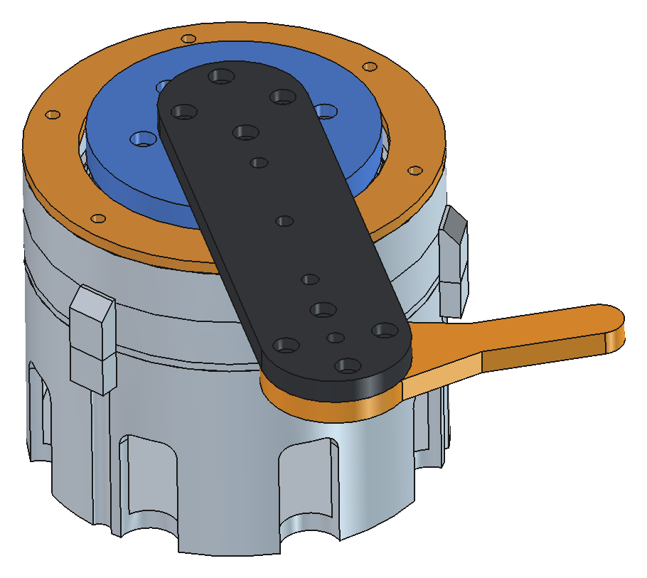
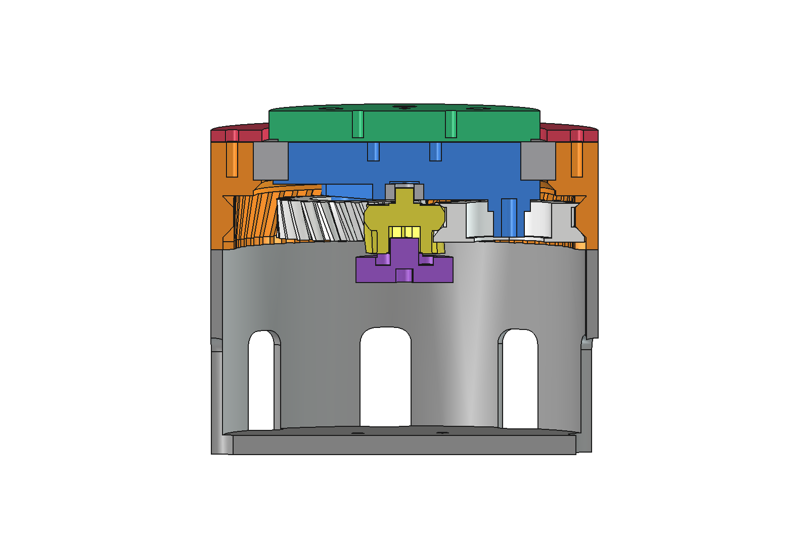
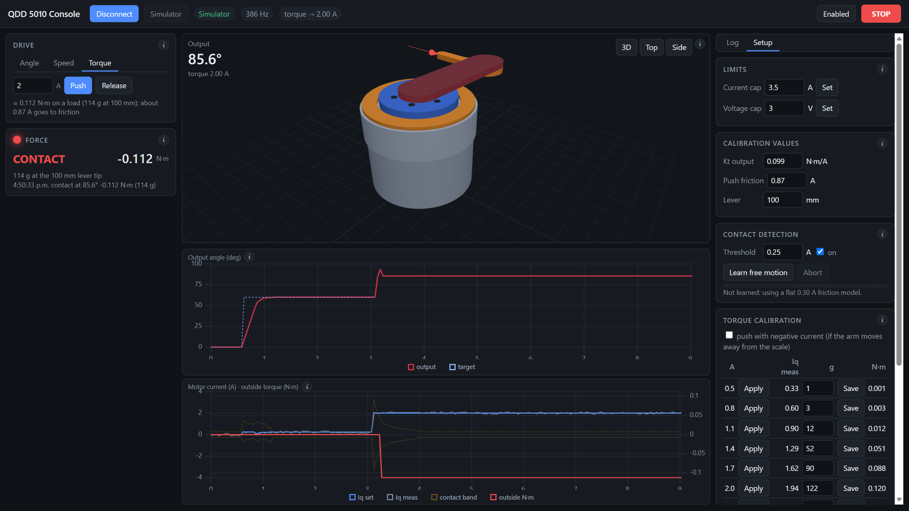
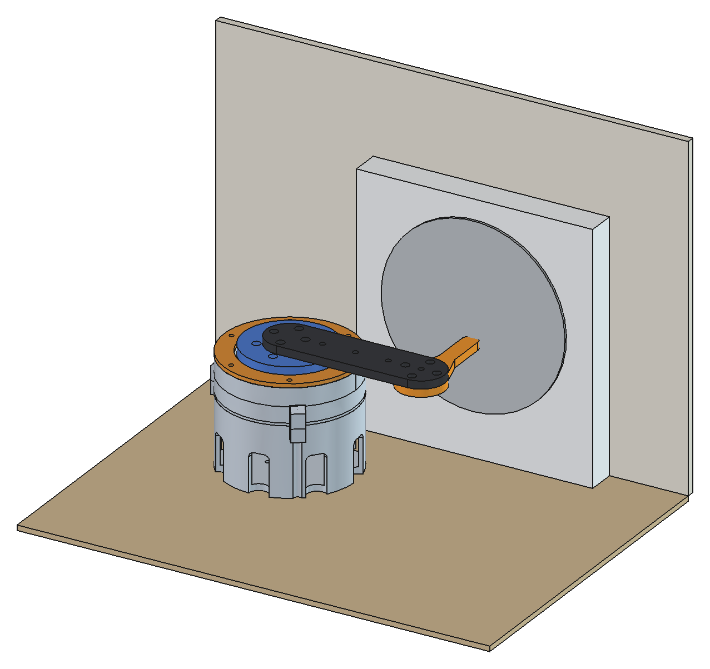
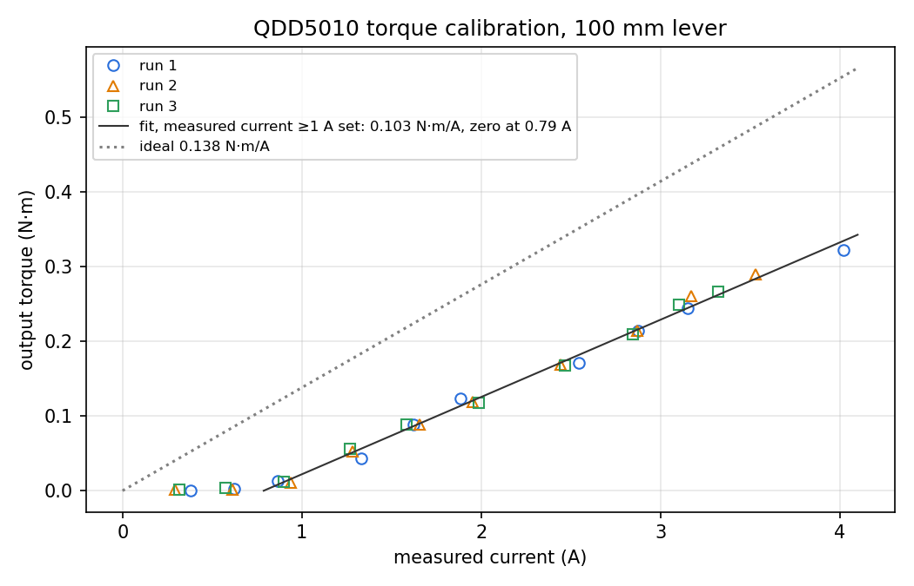

# QDD5010 Actuator

A quasi-direct-drive robot joint built from an MKS 5010 360 KV gimbal motor and a 3D-printed 6:1 planetary gearbox, run with SimpleFOC on an Arduino Mega.

 

The full build and usage guide is [docs/QDD5010 V2 Guide.pdf](docs/QDD5010%20V2%20Guide.pdf).

## Hardware

- Arduino Mega 2560 with a SimpleFOC Shield v2.0.4
- MKS 5010 360 KV motor (7 pole pairs) and an MKS AS5600 magnetic encoder over I2C (Mega pins 20/21)
- 12 V supply
- Printed planetary gearbox, version 2: sun 12 teeth, ring 60 teeth, three planets, carrier output, 6:1

## Repository

| Path | What it is |
| --- | --- |
| `Code/QDD5010/QDD5010.ino` | Firmware: FOC current control with feedforward, angle / speed / torque modes, serial commands and telemetry |
| `Code/WebApp/` | Browser console: drive modes, force readout, live charts, a 3D view, contact detection and torque calibration |
| `docs/QDD5010 V2 Guide.pdf` | Full build and usage guide: parts, assembly, wiring, firmware, web console, tuning, test results and torque calibration |
| `CAD/V2/` | FreeCAD model of the V2 gearbox and the arms, with 3MF/STL files ready to print |

## Firmware

Open `Code/QDD5010/QDD5010.ino` in the Arduino IDE (needs the Simple FOC library), build for the Mega and upload. The serial port runs at 115200 baud. Telemetry is off at boot; send `M` to start or stop it (20 Hz). Power-up limits are 3.5 A and 3.0 V (`C` and `QV` change them, up to 4 A and 3 V).

| Command | Does |
| --- | --- |
| `B<deg>` | Output angle |
| `A<deg>` | Motor angle |
| `S<rpm>` | Output speed |
| `R<rpm>` | Motor speed |
| `T<amps>` | Torque, as q-axis current |
| `Z` | Zero the output angle here |
| `E0` / `E1` | Disable / enable the motor |
| `C<amps>` | Current limit |
| `QV<volts>` | Voltage limit |
| `G`, `H` | Status and help |
| `M` | Telemetry on / off |

## Web console

Open `Code/WebApp/index.html` in Chrome or Edge (it uses Web Serial), click **Connect** and pick the Mega's port. If the browser blocks Web Serial on a local file, serve the folder instead, for example `python -m http.server 8765` in `Code/WebApp`, and open http://localhost:8765 (`start.bat` does this on Windows). **Simulator** runs the console without hardware.

The page has three areas. On the left, **Drive** (Angle, Speed and Torque tabs) and **Force** (FREE/CONTACT and the outside load in N·m and grams). In the middle, a 3D view of the joint with Arm A1 and the pusher, which follows the real angle even with the motor off, and two charts. On the right, **Log** and **Setup** (limits, calibration values, contact detection, the torque calibration table, display and recording). Every section has an **i** button that explains it.

Contact detection compares the current with what free motion needs (a learned friction map per 10° of output plus an acceleration term). Run **Learn free motion** once, with the arm free to swing a full turn, before relying on it during moves.

## Torque calibration

 

Measured on 2026-11-08 with the joint clamped flat, a kitchen scale standing on its edge against a wall and the pusher pressing it at 100 mm. Three sweeps with the current only ever increasing, 0.5 to 4 A:

- Output torque ≈ 0.099 × (Iset − 0.87 A) N·m between 1 and 3.5 A, about ±8 g at 100 mm.
- Against the measured current: 0.103 × (I − 0.79 A) N·m, good up to 4 A (±7 g).
- About 75% of the ideal 0.138 N·m/A (360 KV × 6:1) reaches the output; 0.8–0.9 A goes to gearbox friction when pushing on a load.

The console uses these values (Setup → Calibration values) for its torque hint and force readout.

## Printing

The 3MF files in `CAD/V2/` are the printed parts: base, ring, sun, three planets, carrier, output flange, bearing retainer and rotor adapter, plus two 100 mm arms:

- `PlanetaryGearBox 5010-Arm A1.3mf`: 36 mm wide, 6 mm thick, rounded ends, the flange's 4-hole pattern at both ends and load holes at 25/50/75/100 mm. Bolts to the flange with 4 × M3 × 8 (M3 × 10 would bottom out).
- `PlanetaryGearBox 5010-Arm A1 Pusher.stl`: bolts under Arm A1's tip with 4 × M3 × 8 into 2.9 mm pilot holes; its rounded finger presses a scale exactly 100 mm from the axis.
- `PlanetaryGearBox 5010-Arm.3mf`: the first, tapered arm (4 × M3 × 10).

## License

MIT, see [LICENSE](LICENSE). It covers everything in this repository: the firmware, the web console, the CAD and the guide.
